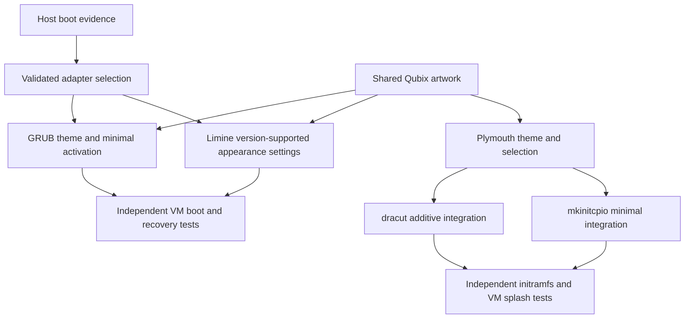

# Boot and splash architecture

Status: **Bootloader adapters Implemented as a test candidate; Plymouth adapters Implemented as a test candidate**. Both GRUB and Limine are mandatory MVP components; neither is a bootstrap host operation.

Installed packages, executable presence, and configuration paths are candidates, not proof of the active loader. Auto selection must reject absent, conflicting, or insufficient evidence. Future firmware/boot-chain inspection and operator-confirmed active paths must precede activation. Never replace a bootloader for branding.

GRUB installs a Qubix theme and changes supported appearance settings or an isolated hook. Preserve entries and kernel arguments; validate both source and generated configuration. Limine edits only installed-version-supported appearance directives in the detected active configuration, preserving entry sections byte-for-byte where practical. It does not inherit GRUB theming assumptions.

Plymouth owns splash selection independently of the loader. dracut and mkinitcpio adapters add only required Plymouth integration. Rebuild affected images only after changed integration/theme inputs, and verify required generated resources. Never take ownership of unrelated hooks, modules, compression, kernel, root, encryption, or hardware settings.

Every boot change requires pre-change content/metadata backups, a known bootable fallback, explicit VM tests, and documented live-media recovery. Recovery must reverse minimal edits and regenerate only necessary outputs using the original platform tools. Host boot and initramfs operations need explicit authorization; static tests cannot authorize or prove them.

The candidate requires operator confirmation of active loader configuration and Limine major version. Auto never guesses from installed tools. Boot-plan reads may need privilege escalation for private configuration; deployment remains opt-in. See [adapter contracts](../components/bootloader.md). Native GRUB generated configurations are preserved; activation uses the existing custom hook.
