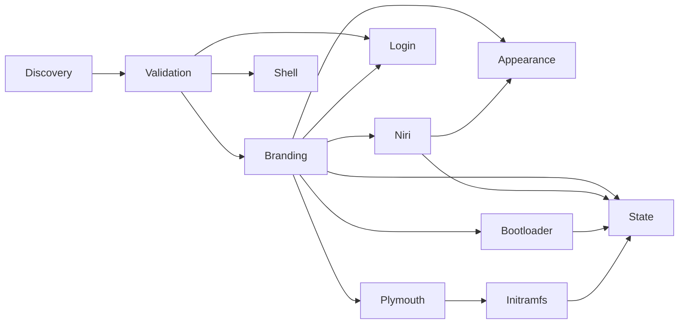

# Component boundaries

Status: **Planned**. Only completed roles listed in [status](../project/status.md) are executable.

| Component | Responsibility | Ownership | Required dependencies |
|---|---|---|---|
| Discovery | Read identity, binaries, package and service evidence | Preserved | Host Python |
| Branding | Qubix-named assets under `/usr/share/qubix/` | Managed | Supported platform |
| Niri | Valid system defaults and optional explicitly adopted user integration | Default; existing files Preserved | Installed Niri; syntax validation |
| Appearance | Wallpaper and companion settings | Default | Branding; measured companions |
| Shell/terminal | Additive defaults and optional personal adoption | Default; personal files Preserved | Detected applications |
| Login | Supported theme activation | Default; authentication Preserved | Active supported display manager |
| Bootloader | Minimal appearance configuration | Managed theme; boot entries Preserved | Selected proven GRUB/Limine adapter |
| Plymouth | Splash installation and selection | Managed theme; unrelated settings Preserved | Installed Plymouth; initramfs adapter |
| Packages/system | Narrow explicitly required dependencies/defaults | Managed named resources | CachyOS adapter |
| State/recovery | Revision manifest, backups, verified restoration | Managed manifest | Resource ownership records |

Bootloader and Plymouth are independent selections. Neither gates the first desktop milestone. Components report installation, syntax validation, session validation, and boot validation separately. A disabled component performs no writes. Unsupported enabled components fail before any component writes.

Detailed contracts: [branding](../components/branding.md), [Niri](../components/niri.md), [bootloader](../components/bootloader.md), [Plymouth](../components/plymouth.md), and [remaining components](../components/remaining.md).
