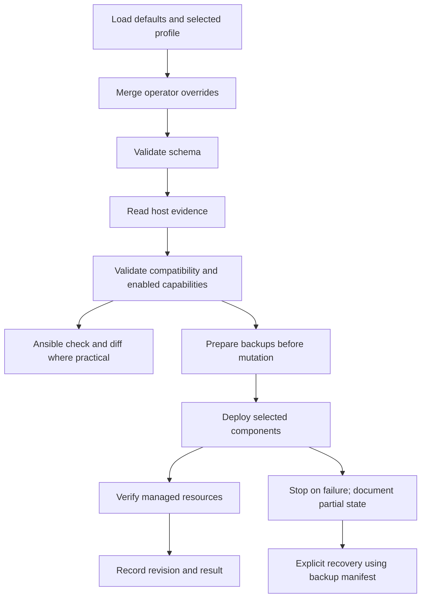

# Deployment lifecycle

Status: **Implemented profile resolution, discovery, compatibility validation and preflight**. Component mutation, backups, state and restoration remain Planned; see [status](../project/status.md).

There is no multi-component atomic transaction. Ansible check mode is an approximation; read-only probes should still run, and missing resources can limit downstream previews. Do not claim planned writes were verified. Do not record a successful deployment before verification.

Inventory and privilege escalation are standard Ansible operator inputs. The local inventory is explicit, with no implicit deployment to arbitrary hosts. Verification must not require privilege escalation for ordinary readable facts; permission failures must be actionable, not interpreted as absent components.

Bootstrap profile resolution loads defaults, the allowlisted profile, and an optional operator mapping (`qubix`), in that order with recursive dictionary merge. Scalar/list replacement is deliberate. Unknown keys and malformed types are rejected, so a misspelled opt-out cannot accidentally activate another component.

Future recovery stores content, metadata, original absence, target paths, and source revision before overwriting default resources. Owned assets are reconciled idempotently; unrelated files must remain untouched. Revision tracking includes Git commit and effective configuration digest, with dirty-tree detection. It is not whole-system rollback.
