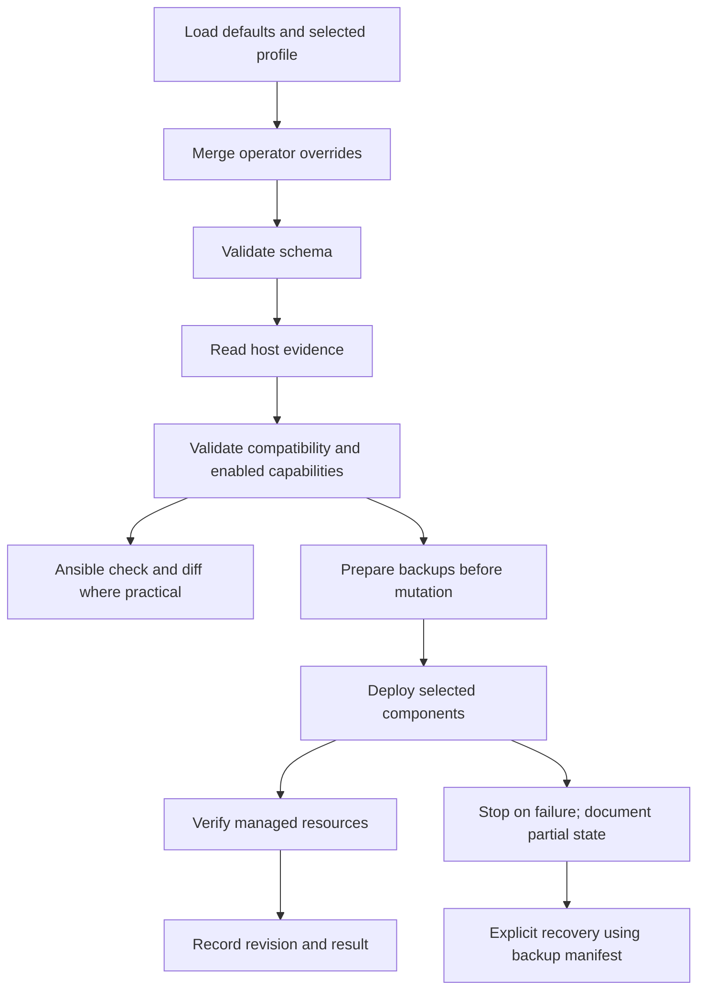

# Deployment lifecycle

Status: **Implemented profile resolution, discovery, compatibility validation and preflight**. Branding mutation and checksum verification are Implemented. Named-file backups, receipts, restoration and revision state are Implemented; all candidate adapters are Implemented; see [status](../project/status.md).

There is no multi-component atomic transaction. Ansible check mode is an approximation; read-only probes should still run, and missing resources can limit downstream previews. Do not claim planned writes were verified. Do not record a successful deployment before verification.

Inventory and privilege escalation are standard Ansible operator inputs. The local inventory is explicit, with no implicit deployment to arbitrary hosts. Standalone verification must not require privilege escalation for ordinary readable facts; permission failures must be actionable, not interpreted as absent components.

Discovery includes the installed Noctalia CLI version when its executable is measured. The read-only probe runs in check mode and reports unknown when Noctalia is absent, allowing components to distinguish standalone releases from legacy or unsupported shells. Package names alone do not establish this API compatibility.

Bootstrap profile resolution loads defaults, the allowlisted profile, and an optional operator mapping (`qubix`), in that order with recursive dictionary merge. Scalar/list replacement is deliberate. Unknown keys and malformed types are rejected, so a misspelled opt-out cannot accidentally activate another component.

Recovery stores content, metadata, original absence and target paths before overwriting default resources. Owned assets are reconciled idempotently; unrelated files must remain untouched. Revision tracking includes Git commit and effective configuration digest, with dirty-tree detection. It is not whole-system rollback.

Current deployment validates all selected component prerequisites first, then escalates for backed-up named file installation and verification. `verify` inspects by default; `verify --tags branding` explicitly checks deployed assets. The wrapper reserves tags for verification; configure enabled components in YAML. A successful file deployment records revision and configuration digest; graphical and boot verification remain false until actual acceptance.

A transient deployment-pending.json is recorded before mutation. Failures retain diagnostics alongside the previous successful deployment.json; only complete file/archive verification clears pending and updates success. This bookkeeping never asserts graphical/reboot acceptance. Image rebuild pending state is independent and triggers retry.

## Packaged source identity

The complete tracked playbook can also deploy from the CI/prerelease source archive.
The [packaging contract](../development/releases.md) defines contents, checksums and
commit substitution. State checks `.git` at the source root explicitly, avoiding an
unrelated parent checkout. Git sources retain measured revision/dirty status; archives
require a full exported `SOURCE_REVISION` and record `source_kind: archive`, `dirty: null`.
Archive identity is provenance, not proof of unchanged extracted files. Installation,
parser, session and boot acceptance remain separate.

## User deployment and developer transport

User deployment MUST run the playbook directly on the CachyOS Niri machine being
customized. The same machine holds the extracted archive/checkout, Python environment,
prepared caches and local overrides. Run as the normal desktop account, never with
`sudo ./bootstrap.sh` or a root Ansible process; individual tasks request sudo as needed.
Use the shipped `inventory/local.ini` (`localhost ansible_connection=local`). SSH is a
developer testing transport for explicitly selected test targets, not a user setup step.
The [user entry point](../user/getting-started.md) and
[developer SSH guide](../development/ssh-testing.md) maintain that separation.

Focused documentation task acceptance: user setup/deploy/restore/preparation commands
use local transport, development retains remote VM testing procedures, all default
selections and machine-specific confirmation gates remain documented, and repository
link/default/shell checks pass. This changes the documented operating procedure, not
Ansible's supported transports or native acceptance evidence.
