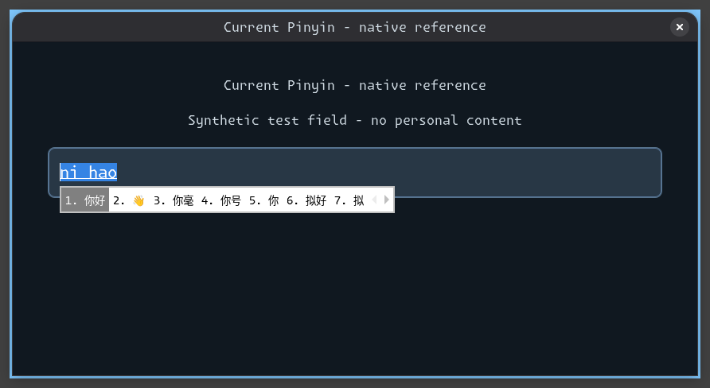
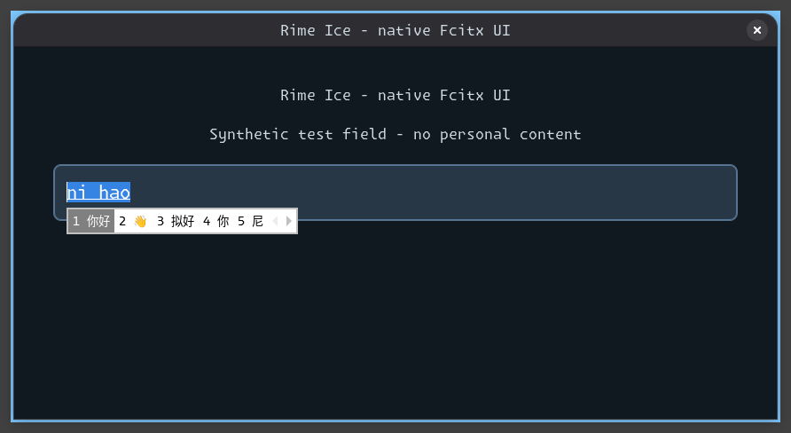
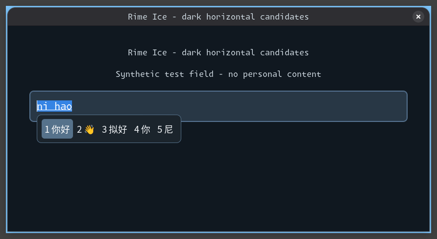
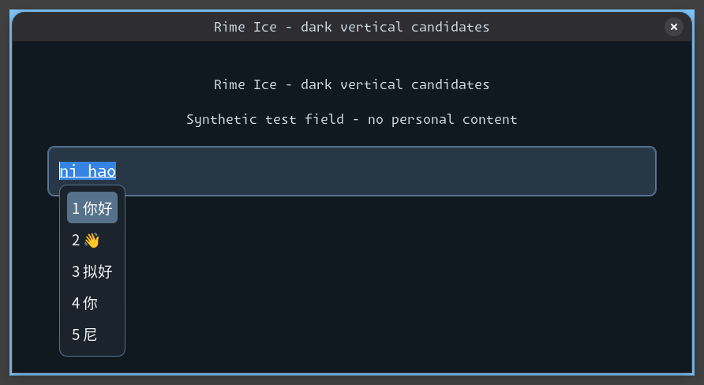

# Input method options and UI exploration

Status: **Native engine comparison and GTK/Niri visual previews Tested; horizontal theme installation/native rendering Tested; Rime production adoption Planned**. User priorities: candidate-window appearance/placement and
candidate quality/ranking. Focused task: evaluate Rime on the existing CachyOS Niri
SSH target and compare concrete candidate UI options. Acceptance: native engine
conversion and candidate samples, sanitized native-reference/customized previews,
identified sources/environment, preserved live desktop/personal input data, and a
recommendation with explicit limitations. This is exploration; production integration
and any replacement of the active engine are a separate follow-up.

Fcitx owns application integration and the candidate window; Rime supplies conversion
through `fcitx5-rime`; its schema/dictionaries determine input behavior. Replacing the
engine alone does not replace the visible UI. Existing [input contracts](../components/input-method.md)
and the Super+Space launcher fix remain in force.

## Options to compare

| Option | Expected benefit | Tradeoff and fit |
|---|---|---|
| Fcitx Pinyin with a larger, themed candidate window | Improve legibility, density and layout without migrating the engine | Lowest migration cost; dictionary/ranking behavior largely stays as today |
| Fcitx + Rime Luna Pinyin Simplified | Official Rime schema, conservative baseline, customizable rules | Older baseline vocabulary; must explicitly select the Simplified schema |
| Fcitx + Rime Ice | Simplified-first full Pinyin/double Pinyin, maintained dictionaries, mixed English/Chinese and correction features | More data/Lua dependencies and reproducible source preparation; quality must be measured with the user's vocabulary |
| Fcitx + Rime with an optional grammar model | Potential contextual/long-sentence gains | Larger model and separate pin/license/update lifecycle; improvement is not guaranteed |
| Fcitx + Rime Ice with Catppuccin or Material Color | Alternative candidate-window palettes/geometry while keeping the same tested engine | Theme choice changes presentation, not dictionaries; neither theme is activated by this evaluation |
| IBus + Rime | Alternative application integration framework | Does not inherently improve the same Rime dictionaries; a framework migration needs separate Niri/toolkit acceptance |

UI prototypes should compare the native reference against a compact dark horizontal
list and a dark vertical list with larger Simplified Chinese typography. Match Qubix's
existing palette, retain numbered candidates, readable preedit and obvious selection.
Do not force a monospaced Latin UI font onto Chinese candidate text. Placement needs
real toolkit/Wayland tests; a theme cannot fix protocol positioning failures.

## Sources

- [Fcitx Rime integration](https://github.com/fcitx/fcitx5-rime).
- [Official Luna Simplified schema](https://github.com/rime/rime-luna-pinyin/blob/master/luna_pinyin_simp.schema.yaml).
- [Rime Ice features and limitations](https://github.com/iDvel/rime-ice).
- [Material Color theme and inline preedit options](https://github.com/hosxy/Fcitx5-Material-Color).
- [Catppuccin candidate themes](https://github.com/catppuccin/fcitx5).
- [IBus Rime](https://github.com/rime/ibus-rime).
- [Fcitx Wayland integration](https://fcitx-im.org/wiki/Using_Fcitx_5_on_Wayland/en).

Ice's upstream quick installation suggests clearing its destination. Our evaluation
uses a fresh private directory and never clears or overwrites personal Rime data.
No upstream installer script is executed. Runtime tests do not establish a general
ranking advantage or accept physical application behavior.

## Native engine findings

The operator-selected SSH target installs `fcitx5-rime` 5.1.16-1.1 and librime
1:1.17.0-6.1 using normal Pacman signature/dependency checks (two tasks, one package
transaction). Existing Pinyin and the active Fcitx daemon remain available. A completed
private-bus comparison passes 12 tasks/eight temporary-file changes with cleanup.

Ice source is pinned to `da1fbe602e38f26db846fa10120ee64c2b0324c0` (2026-10-05), archive
SHA256 `6e6c0e8c00b969690dbc8b394b0a8f8cb0ed3ad348297ad631de1790c693eebb`.
The test uses the target's installed Lua plugin, fresh per-engine data/config/cache,
a private bus without desktop service activation, and synthetic keys sent only to
private input contexts. All three configurations commit `你好` and `汉语` correctly.
The schema for Luna is explicitly `luna_pinyin_simp`; Ice uses `rime_ice`.

| Input | Current Pinyin: first three candidates | Luna Simplified: first three | Ice: first three |
|---|---|---|---|
| `hanyu` | 汉语, 韩愈, 韩语 | 汉语, 韩语, 韩愈 | 汉语, 韩语, 韩娱 |
| `rengongzhineng` | 人工智能, 人工, 任公 | 人工智能, 人工, 认供 | 人工智能, 人工智能编程, 人工智能操作系统 |
| `shurufa` | 输入法, 🔠, 🔡 | 输入法, 输入, 澍濡 | 输入法, 输入, 书 |
| `github` | 个I太湖边, fichu, 个I他湖北 | 个, 给, 过 | GitHub, GitHub Pages, GitHub Actions |

The same run also samples `nihao`, `jisuanji`, `kaifazhe` and `weixin`.
These eight inputs are a small synthetic comparison, not a general ranking benchmark;
results can change with dictionaries, learned history and context. Ice's technical-word
coverage is promising for this developer desktop. No optional external grammar model
is added, and no claim of improved long-sentence accuracy is made.

Recommendation: **Fcitx 5 + Rime Ice + a larger dark candidate window**.
Retain Ctrl+Space and the corrected Super+Space launcher ownership. Prefer horizontal
candidates for short words, or vertical candidates when reviewing longer phrases and
annotations. Keep current Pinyin as a fallback during subsequent application acceptance.

The optional [native engine/UI workflow](../../tests/integration/input-options.yml)
requires the pinned archive at `.cache/rime-exploration/ice.tar.gz`; the URL/checksum
are in [its manifest](../../tests/integration/fixtures/input-method/ice.yml).
It is an explicit developer test, excluded from ordinary deployment/CI fixture runs.
No personal dictionary or live input profile is replaced.

## Native UI comparisons

Source: parent Qubix revision `3aa6dc1` plus the evaluation helpers/theme committed
with this document. Captured on 2026-10-21, CachyOS x86-64, Niri 26.04 (`8ed0da4`),
Fcitx 5.1.23-1.1, GTK 3.24.52-2.1, Noto CJK 20240730-1, and the pinned Ice revision
above. All images capture a private nested compositor and a synthetic GTK input field.
They are **previews**, not live activation or primary-session screenshots. No personal
content or postprocessed composition is included.

| Native reference | Engine-only change |
|---|---|
|  |  |

Left: existing Pinyin, native Sans 10 and seven candidate slots. Right: Ice with the
same native appearance and five candidates. The engine change alone leaves the small
white candidate window largely unchanged; different candidate count/content is intentional.

| Dark horizontal candidate preview | Dark vertical candidate preview |
|---|---|
|  |  |

Both custom previews use Noto Sans CJK SC 14, five numbered candidates, Qubix's dark
surface/steel-blue selection, original rounded SVG backgrounds, and embedded preedit.
Only orientation differs. Horizontal occupies less space; vertical keeps each phrase on
its own row. These original theme fixtures are not installed by ordinary deployment.
Measured popup sizes are 421×34 (current Pinyin), 261×30 (Ice/native),
295×58 (dark horizontal) and 84×218 (dark vertical) logical pixels.
Mouse page controls, long-candidate clipping, screen edges, HiDPI and Qt/Electron need
additional acceptance before calling this a complete production input UI.

### The integration issue discovered by rendering

An initial preview set Fcitx's server config/data paths correctly but still rendered a
small white horizontal popup for both custom layouts. GTK's client-side renderer reads
standard XDG configuration/data paths independently of the daemon's FCITX_CONFIG_HOME.
The corrected preview supplies matching settings/assets to both readers; native screenshots
then show the expected dark layouts. The test now gates popup geometry/orientation as
well as committed text, so the earlier unstyled fallback cannot pass as a custom UI.
See the [upstream GTK config reader](https://github.com/fcitx/fcitx5-gtk/blob/master/gtk3/fcitxtheme.cpp)
and [client/server theme explanation](https://fcitx-im.org/wiki/Theme_Customization).

Four real GTK input contexts commit `你好`; separate backend tests verify `汉语` and
all eight candidate samples. The combined workflow passes 17 tasks with ten temporary/
artifact changes and zero failures, preserves personal settings and the primary Niri,
and reports zero remaining preview processes. [Candidate samples](../assets/input-methods/comparison.json)
and [preview hashes/preservation result](../assets/input-methods/result.json) accompany the captures.
The initial interrupted SSH run is not counted as completed acceptance. Its private
root is subsequently removed after verifying the successful preview cleanup receipt;
a read-only audit confirms no remaining comparison directories and only the original
primary Fcitx PID 93757. No compositor/shell restart, authentication or boot test occurs.

## Recommended next implementation

Promote Rime Ice plus the horizontal Qubix candidate UI as the supported profile's
default, retaining current Pinyin as a fallback. Pin source data and licenses, separate
preparation from deployment, preserve existing Rime customizations/learned dictionaries,
and make theme/config assets discoverable to GTK and Qt clients as well as the daemon.
Avoid copying Ice's upstream clear-the-directory installation procedure into deployment.
Verify initial schema deployment/readiness so a cold engine does not pass early letters
through as raw text; the preview explicitly waits for Rime's reported current schema.
Retain Ctrl+Space and the fixed launcher binding; add a discoverable native configuration
application and validate paging/selection in real applications. Optional grammar models
remain a separate measured choice. Production adoption has **not** occurred in this
exploration; the operator's active input profile remains unchanged.

The follow-up installs the horizontal theme independently of Rime migration. See
[production UI ownership and acceptance](../components/input-method.md). The earlier
captures above remain isolated previews; current installed-theme evidence belongs
in the [Pinyin test results](../project/pinyin-test-results.md).
