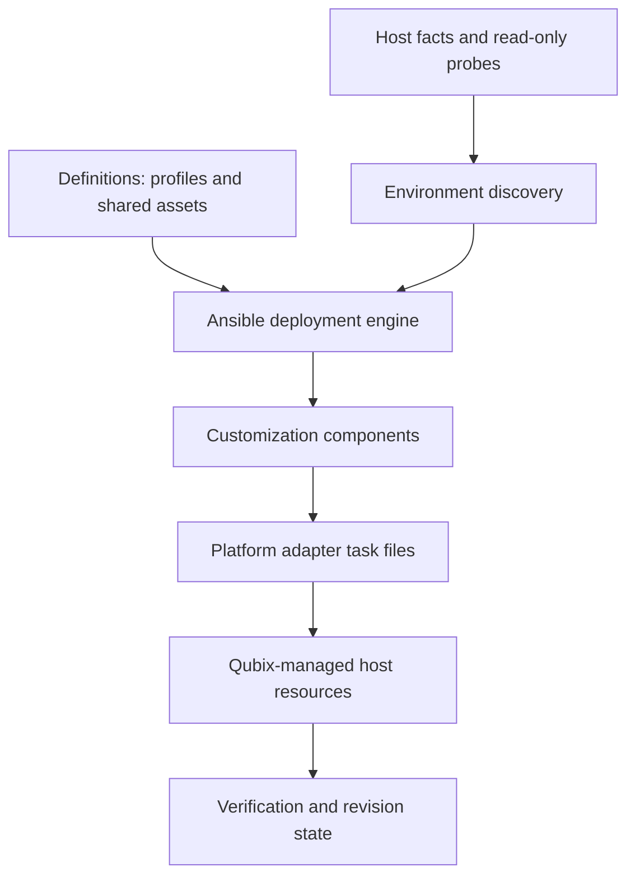

# Architecture overview

Status: **Implemented MVP candidate layers; native acceptance pending**. Implementation evidence lives in [status](../project/status.md).

Five conceptual layers use ordinary Ansible roles, task files, and variables. Definitions express intent; discovery measures capabilities; orchestration resolves and validates a profile; components own a narrow resource set; adapters translate component needs to the installed platform. Avoid abstract base classes, plugins, and a separate CLI.

Initial platform: CachyOS, Pacman, systemd, and an installed Niri binary. Supporting applications are discovered rather than assumed. Bootloader installation evidence is distinct from active bootloader evidence. Fedora/KDE extension points are documented only.

[Components](components.md), [deployment](deployment.md), [configuration](configuration.md), [boot](boot.md), and [compatibility](compatibility.md) are authoritative for their respective contracts.
