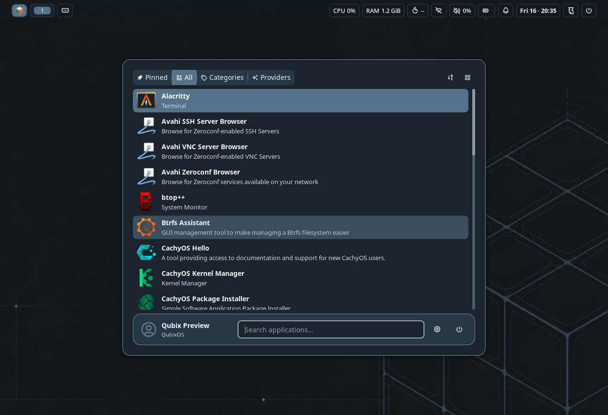
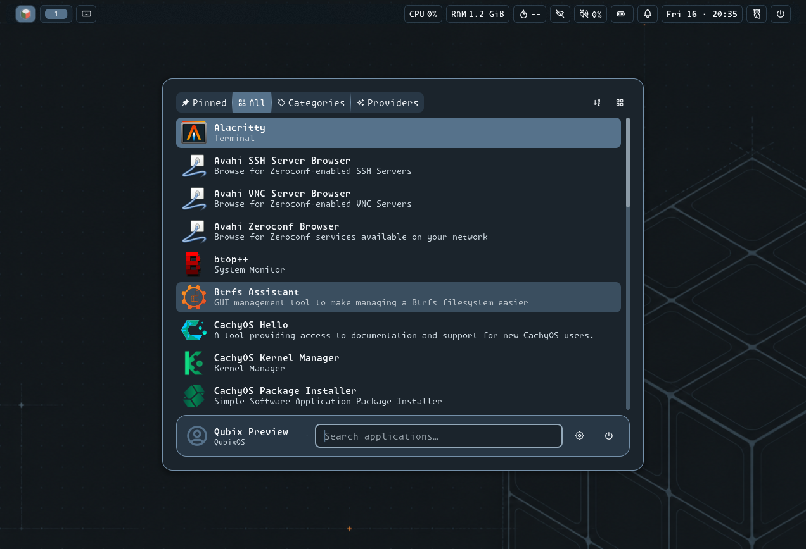
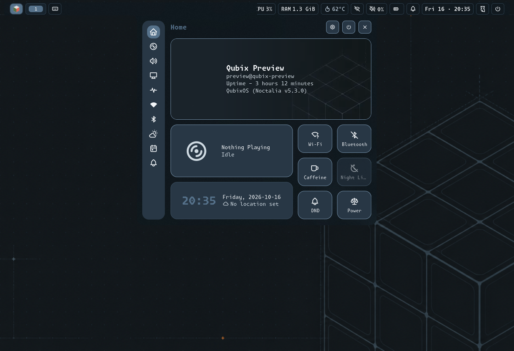

# Monaspace NF and Krypton UI test results

Status: **Source Implemented; controller/native preview Tested; deployment In Progress**.
The [font contract](../components/fonts.md) owns scope and acceptance.

## Native comparison

2026-10-16, CachyOS Niri 26.04 (`8ed0da4`), Noctalia 5.3.0, Pango/Fontconfig
2.18.3. The preview uses the installed private Qubix Noctalia client for both cases,
with the same managed configuration, palette and wallpaper. The only intentional
configuration difference is `shell.font_family`: generic `sans-serif` (Noto Sans)
versus `Monaspace Krypton NF`. Live hardware readings/time can change between captures.
Monaspace source: official v1.400, revision `f31794b6e9e65698a062262e2f826f679dcb7070`;
the [manifest](../../assets/fonts/monaspace-nf.yml) pins all exact file bytes.
Playbook source starts at `ecec412` with this feature's tracked changes; the production
Noctalia template SHA256 is `0fac7dd93f88fa756a94ec5bf8844ec232095697e00767eaa6b29a8f84f981f7`.

These are **isolated native previews**, not live activation captures. Synthetic
`preview` identity, private state/cache, a private D-Bus and nested Niri exclude
personal content and authentication operations. The 1280-by-900 requested nested
window yields 1272-by-868 captures inside the parent frame. Actual font resolution,
warning-free native TOML parsing, distinct rendered images, preserved personal settings
and main compositor, and zero remaining preview processes pass. No real biometric,
power or boot action runs. Krypton's wider text changes line lengths and causes
native ellipsizing in fixed-width tiles; icons continue through font fallback.

| Surface | Generic reference | Krypton default |
|---|---|---|
| Launcher |  |  |
| Control Center |  |  |

## Controller and installation evidence

`./scripts/validate.sh` passes YAML, Ansible syntax/lint, shell checks, repository
consistency, JavaScript checks and diff whitespace. The framework fixture passes
827 tasks/zero changes with expected refusals; desktop ownership/version regression
passes 69 tasks/zero changes with seven expected refusals.

`tests/playbooks/fonts.yml` uses disposable synthetic font bytes and no-effect native
tools, independently of the large source download. Normal mode passes 313 tasks/33 disposable changes; global check mode passes 128
tasks/14 setup/cleanup changes, with one expected source refusal in each. They prove checksum
refusal, both Noctalia/Fontconfig selections, exact installation/verification,
unchanged reapplication and original-absence restoration. They do not prove native font validity.
`playbooks/prepare-fonts.yml` accepts the pinned archive and extracts the source;
all 210 manifest checksums match. The complete focused native plan passes 92 tasks,
zero changes, before installation. GTK defaults are additionally validated by strict
private schema compilation and a transient GSettings backend in the native workflow
(65 tasks, ten temporary changes; preserved main Niri/settings and zero leftover processes).
A focused native alias/orthography fixture passes six tasks/four temporary changes:
all four generic requests select Krypton while an explicit Noto Sans request retains Noto.
The aliases inherit matched binding strength; CLI probes escape hyphens because Fontconfig
pattern syntax otherwise parses `system-ui` as family `system` and a size suffix.
Future comparisons request the measured Noto Sans baseline explicitly, so installing the
system aliases cannot turn both comparison cases into Krypton.

Target installation, full 210-face native validation, live shell activation,
unchanged reapplication and protected-resource audit are the remaining deployment gates.
No boot check is required for desktop fonts; boot font/image selections are preserved.
