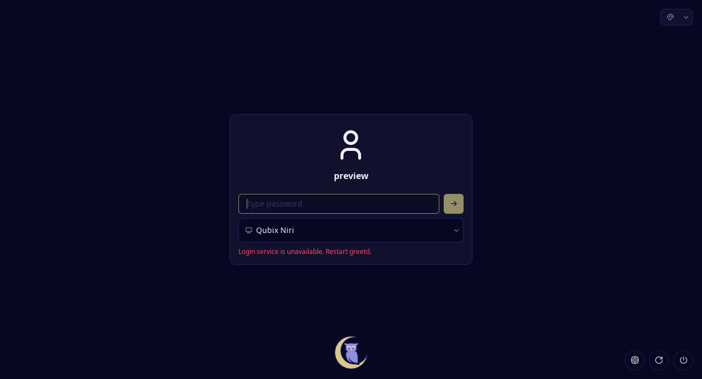
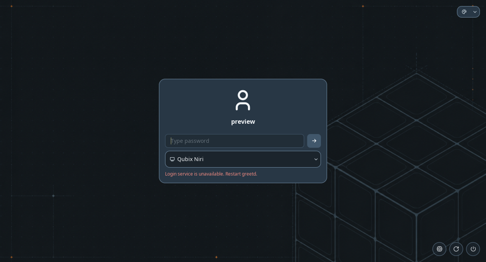

# Noctalia Greeter test results

Status: **Implemented; native client preview Tested; login acceptance pending**. Contract:
[login appearance](../components/login.md). Operator procedures:
[greeter](../user/login.md) and [fingerprint enrollment](../user/fingerprint.md).

## Source and environment

The reviewed release is Noctalia Greeter v1.6.0, upstream commit
`44337ecba043749c29de6f3d563315b91987a908`. The target is the previously configured CachyOS
Niri desktop, with Noctalia 5.3.0-1.1, Greeter 1.6.0-1 and greetd 0.10.3-2.1.
SDDM remains active. The native package supplies the `greeter` account and 0750 state directory.
The theme uses the playbook's existing Noctalia palette and desktop cube wallpaper.

## Package preparation

The separate `playbooks/prepare-login.yml` check-mode preview passes 46 tasks with zero changes.
Actual installation passes 47 tasks/one package-transaction change. It installs seven packages:
greetd, greetd-agreety, noctalia-greeter, libliftoff, wayland-protocols, xcb-util-errors and wlroots0.20.
No database refresh or system upgrade is requested. The package-created state directory already
exists, so the fallback tmpfiles initializer is skipped. Native package installation supplies
greetd's authentication files; no Qubix PAM customization or upstream setup script runs.

The before/after protected audit finds only `/boot/limine.conf` changed among the earlier
76 tracked resources, from native snapshot hooks. Every earlier recovery manifest, receipt and
original backup is unchanged. This is package preparation evidence, not a new boot-theme activation.

## Fixture evidence

The new disposable-root fixture passes 414 tasks in normal mode and 286 tasks in global check mode,
with twelve expected refusals in each. The temporary setup/cleanup changes
are isolated fixture operations. It exercises shared-palette rendering, retained session/input/
output/auth/per-output-wallpaper settings, original file restoration, unchanged resource copies,
measured version boundaries, manager activity, noncanonical/malformed TOML and redirected configs.
No native authentication or service command runs in these fixtures.

The expanded schema/discovery fixture passes 609 tasks with zero changes (34 profile, eleven
host, seven identity cases and normalization). The original SDDM fixture passes 58 tasks with two
expected refusals. `./scripts/validate.sh` passes static checks, syntax/lint and repository links.

## Native comparison

The native comparison passes 87 tasks/four temporary changes. It runs the actual packaged client
under Niri 26.04 in a temporary 1272×688/100% output, with synthetic `preview` identity, private
runtime/state, a non-activating private D-Bus session and a nonexistent greetd socket. The primary
Niri process and four personal/GUI configuration hashes remain unchanged; no test process remains.
The greeter logs contain no unknown configuration keys, invalid TOML or incomplete-palette warning.

Source: repository base `e526a2c` plus the Noctalia Greeter implementation recorded with these
screenshots; upstream Greeter release/revision above. The reference uses built-in appearance.
The customized candidate uses the same sixteen Qubix palette roles as the desktop, its existing
cube wallpaper, dark mode and 1.35 corner-radius scale. The initial Noctalia wordmark is hidden.
The unavailable-login warning is intentional in both captures: the preview cannot authenticate.
No personal account, avatar, application window or enrolled fingerprint appears.

Reference: unmodified built-in Noctalia scheme and wordmark, synthetic user, native UI client under
nested Niri; this is a preview, not the active login screen.

Customized: shared steel-blue surfaces and cube wallpaper, preserved original wallpaper colours,
hidden native wordmark and matching rounded panel. Same environment and synthetic user as reference.

Native UI rendering is separate from greetd's DRM/VT compositor, actual password authentication
and reboot acceptance. No fingerprint enrollment or PAM edit is performed by the task.
