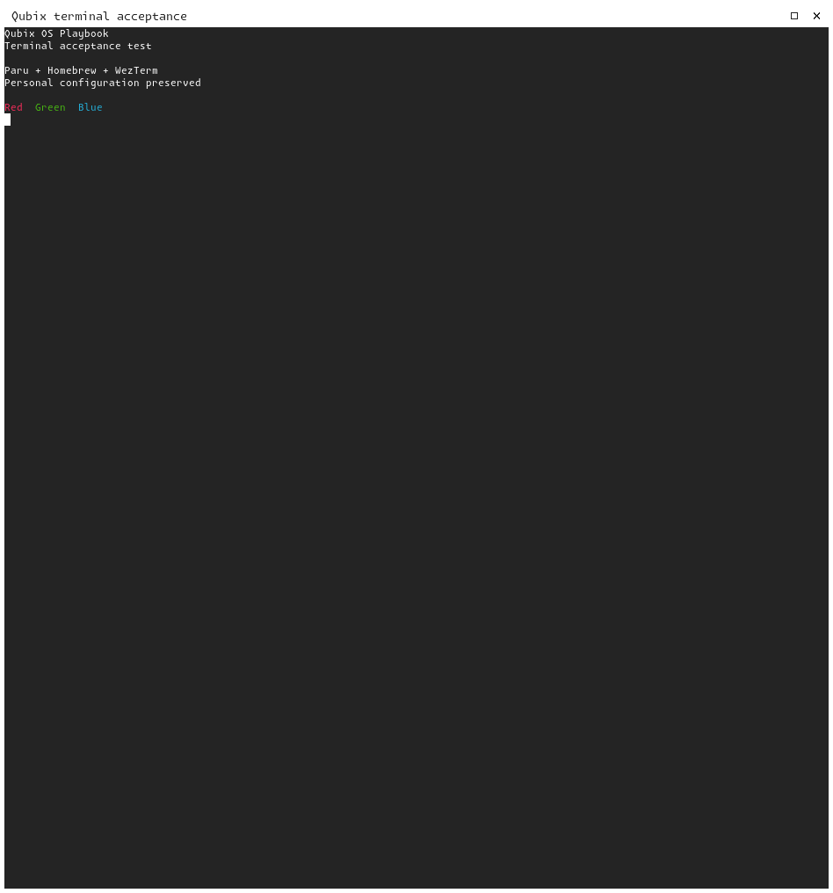
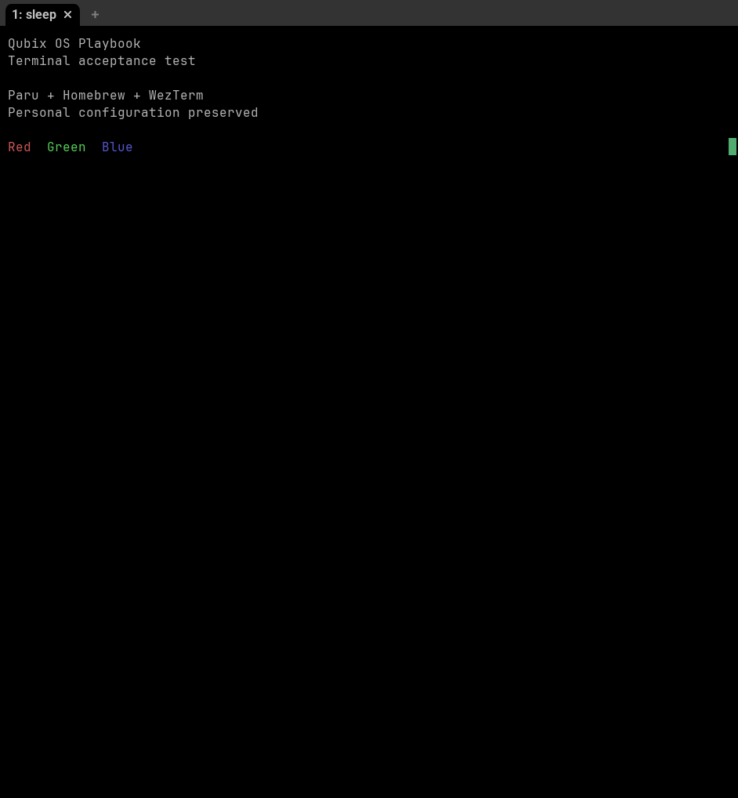

# CachyOS package managers and WezTerm deployment

Status: **Native package installation/removal, existing-manager preservation, parser
validation, synthetic terminal rendering, active-shell selection and zero-change
reapplication Tested**. Fresh Homebrew bootstrap and physical shortcut input remain
separate acceptance gates. Source revision: `ee71994` on 2026-10-17.

The operator explicitly requested deployment to the existing SSH instance. Environment:
CachyOS x86-64, active Qubix Niri PID 1145, 1920×1080 display at 100% scale,
standalone private Noctalia, ordinary account with sudo. Bootloader/Plymouth and login
changes were excluded. The existing Brew 7.0.9 and Paru 2.1.0-3 were retained;
WezTerm `20240203.110809.5046fc22.r869.g76b606ec5-3.1` was installed, and
Alacritty 0.17.0-1.2 / Foot 1.28.0-2.1 were removed with native dependency checks.

| Gate | Actual evidence |
|---|---|
| Package preview | Production preparation playbook: 51 tasks, zero changes; only WezTerm missing; both removals accepted by Pacman. |
| Package installation/removal | 54 tasks, two package transactions, zero failures; Paru/WezTerm/Brew version probes pass before removal. |
| Package reapplication | Production preparation playbook: 50 tasks, zero changes/failures. Existing Brew and installed formulae are not reconciled or updated. |
| Desktop preview | 99 tasks, exactly two proposed files: Niri configuration and Noctalia launcher. Diff contains only terminal environment and the two terminal commands. |
| File installation | Shared protected-file engine: 107 tasks, four changes (two files and their applied receipts). First baselines remain retained. Full-profile deployment record is preserved; this is targeted resource installation. |
| Desktop reapplication | The same two resources: 107 tasks, zero changes/failures. |
| Parser validation | Installed `niri validate --config /etc/niri/qubix/config.kdl` and `bash -n` on the launcher pass; copy-time validation also succeeds. |
| Session activation | Explicit Niri configuration reload succeeds. A guarded detached Noctalia-only restart changes PID 1214 to 10663; its active environment selects `/usr/bin/wezterm`. Niri PID 1145 and application-window IDs remain unchanged. |
| Preservation | All 11 measured native/personal configuration hashes match, including native Niri fragments, personal Alacritty configuration and Qubix Noctalia settings. Activation separately preserves dconf and Qubix GUI settings hashes. Boot ID remains `be7bf359-b534-4227-9947-f34d2b63936d`. |
| Boot | No reboot or Qubix boot activation/rebuild. Native package hooks remain enabled; package-hook effects are separate from boot branding. |

The private activation helper refuses to interrupt a locked session or open panel and
restores the original application GSettings backend. It verifies unchanged application
window identities and personal settings. The final check confirms both installed
terminal bindings execute `wezterm start`, the active Qubix session uses that config,
and neither `/usr/bin/alacritty` nor `/usr/bin/foot` exists. Physical Super+T and
Super+Return input and terminal-launching application actions were not synthesized.

## Sanitized reference and replacement comparison

Both captures contain only fixed synthetic text, use temporary HOME/XDG directories,
and run on the existing compositor without loading personal terminal configuration.
The reference uses Foot's native defaults (`--config=/dev/null`), with only its
executable extracted from the retained package cache into the private test directory;
it was not reinstalled. The replacement uses installed WezTerm native defaults
(`--skip-config`, a separate process). These are real application rendering captures,
not whole-desktop appearance or physical shortcut acceptance. WezTerm's native tab
bar, colours, text size and padding intentionally replace Foot's defaults; Qubix adds
no terminal appearance override. Both test windows close, the previously focused
window is restored, and all original window IDs/PIDs remain. Temporary reference
executables, logs and images are removed from the target after fetching these images.

Native Foot 1.28.0 reference on the CachyOS Qubix Niri session, source `ee71994`;
synthetic content, native defaults, no personal configuration.

Installed WezTerm replacement on the same session and source revision; synthetic
content and native WezTerm defaults. This verifies window creation and rendering.

## Remaining acceptance

- Exercise fresh Homebrew installation, incomplete-prefix recovery and dependency-blocked
  terminal removal in a disposable CachyOS VM. This target already had working Homebrew.
- Confirm physical terminal shortcuts and application requests to open a terminal.
- The native package version and rendering evidence apply to this measured target;
  no unrelated desktop, login, boot or full-profile acceptance is claimed.
