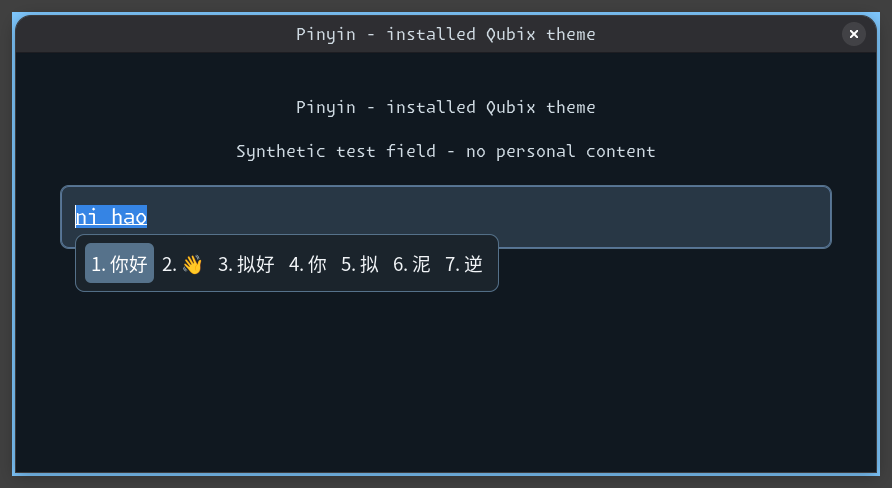

# Native Pinyin results

Date: 2026-10-21. Status: **Implemented; installation/parser/engine/primary daemon
and reapplication Tested; physical application typing and fresh-login startup pending**.
Contract and acceptance: [input methods](../components/input-method.md).

Source: parent revision `0450ea2` plus the Pinyin change committed with this document.
Environment: operator-selected SSH CachyOS x86-64 target, active Qubix Niri process
1145 on `wayland-1`. No reboot or compositor/shell restart. SSH is developer testing;
user preparation and deployment still run locally with `inventory/local.ini`.

## Installation and package preparation

The explicit production `prepare-packages.yml` transaction stops before package
installation: CachyOS mirrors return 404 or invalid signatures for marisa/opencc.
An attempted configured Arch mirror retry also stops before installation on missing
files. No signature setting, database, repository configuration or system package is
upgraded to bypass these failures.

The two absent dependencies are installed from the official Arch archive at the
versions already advertised by the target's existing `extra` database: marisa
0.3.1-1 and opencc 1.4.0-1. Pacman verifies signatures/dependencies normally.
The four Fcitx packages then install from the existing configured repositories:
fcitx5 5.1.23-1.1, chinese-addons 5.1.15-2.1, gtk 5.1.7-1.1 and qt 5.1.16-2.1.
CJK fonts were already installed. This is a target-specific preparation workaround;
the shipped preparation command continues to use the normal configured repositories.
The production package-selection role subsequently passes four tasks/zero changes,
requiring both missing/removal lists empty.

A focused developer playbook renders production roles and reconciles only
`/etc/qubix/fcitx5/profile`, `/usr/share/qubix/bin/qubix-fcitx5` and
`/etc/niri/qubix/config.kdl` with the normal protected baseline/receipt engine.
Installation: **128 tasks, nine changes, zero failures** (including recovery state).
Identical-source reapplication: **125 tasks, zero changes, zero failures**.
No home configuration, boot resource or unrelated desktop resource is deployed.

`pacman -Qkk` reports zero altered files in all four Fcitx packages:
562/271/35/139 files respectively. Packages and runtime user data are outside managed
system-file restoration; the three installed integration resources retain baseline recovery.

## Parser and actual native input conversion

Production copy validation and separate `niri validate --config
/etc/niri/qubix/config.kdl` both pass. The executable launcher passes Bash parsing.
The native [integration playbook](../../tests/integration/pinyin.yml) passes
**six tasks, three temporary-file changes, zero failures**, with cleanup.

Real Fcitx loads the installed system defaults on a private session bus with its own
configuration/data/cache. A synthetic client sends keys only to its own D-Bus context:
Ctrl+Space, `nihao`, Space commits **你好**; `hanyu`, Space commits **汉语**.
The second phrase distinguishes Simplified Chinese from Traditional Chinese 漢語.
All ten Pinyin letters are consumed. A second run with a private English-only personal
profile consumes none of those letters and commits no Chinese text, proving personal
precedence over the managed Pinyin profile. That profile's bytes remain unchanged
during the test. Both test daemons exit and temporary data is removed.

## Primary session and preservation

Niri spawns the installed launcher explicitly after its validated configuration reload.
One primary Fcitx daemon (PID 93757 at inspection) runs; its controller reports
`('us', [('keyboard-us', ''), ('pinyin', '')])`. Its measured environment contains:
GTK_IM_MODULE=fcitx, QT_IM_MODULE=fcitx, XMODIFIERS=@im=fcitx,
WAYLAND_DISPLAY=wayland-1 and
FCITX_CONFIG_DIRS=/etc/qubix/fcitx5:/etc/xdg/fcitx5.

Before/after primary activation, personal Niri/Noctalia/WezTerm and greetd PAM hashes
match; personal Fcitx profile/config remain absent. Niri PIDs 1145/1242 and boot ID
remain identical. The test does not send physical keys, switch the focused application's
input method, terminate applications or change authentication.

## Controller checks and remaining gates

Desktop fixtures pass **84 tasks/zero changes/eight expected prerequisite refusals**
in normal and check modes; package fixtures pass **28 tasks/zero changes/three expected
prefix refusals** in both modes. Repository static validation passes, retaining existing
local-YAML and Limine-spacing warnings.

No graphical theme is customized or screenshot acceptance claimed. The private-context
test proves actual engine conversion, independently of toolkit rendering. GTK/Qt plugin
files are installed and session environment is measured; physical typing, candidate
window placement, WezTerm and Electron/Chromium behavior still require application tests.
Already-open applications and the running shell may retain their original environment;
logout/login activates the complete session startup path. Fresh-login autostart remains
a separate gate. No boot test is performed or implied.

## Super+Space conflict correction

Source: parent `0933893` plus the correction committed with this section, same SSH
environment. Native `GetConfig(fcitx://config/global)` reveals built-in group cycling
on Super+Space and Shift+Super+Space, conflicting with the existing Niri launcher.
The strengthened private-bus regression fails against that installed configuration
before writes, specifically at the forward group shortcut assertion.

An additional managed `/etc/qubix/fcitx5/config` clears only forward/backward group
shortcuts. Personal global configuration retains precedence. Production rendering now
includes 20 base system resources; Niri's Super+Space launcher binding remains intact.
Focused installation of only the new file passes **92 tasks/three changes** with
baseline recovery; identical-source reapplication passes **91 tasks/zero changes**. The running daemon's `ReloadConfig` and subsequent `GetConfig`
report empty group shortcuts and Control+space among the retained trigger keys.
Fcitx PID 93757 stays unchanged; personal-file hashes, Niri PIDs and boot identity
match across live reload. No compositor or shell restart occurs.

The native regression now passes **six tasks/three temporary-file changes**, including
both empty group shortcut assertions, retained Ctrl+Space, real `你好`/`汉语` conversion
and personal profile precedence. Desktop fixtures pass **84 tasks/zero changes/eight
expected refusals** in normal/check mode, and static validation passes.
Physical Super+Space launcher interaction remains an operator check; no physical input
is injected into the primary session and no boot work is performed.

## Candidate theme activation

Source: follow-up to `856fd90`, using the production theme assets in this change.
Environment: the same CachyOS SSH target, Niri 26.04 (`8ed0da4`), Fcitx 5.1.23,
GTK 3.24.52, 100% nested output. The user reported that the candidate theme was
absent: the previous Rime exploration copied it only into private preview roots.
Read-only inspection found no system or personal `classicui.conf`.

The installed-resource regression (`tests/integration/input-theme.yml`) seeds only
an isolated Pinyin profile. It does not copy private theme assets or UI config:
both native renderers must resolve the actual system paths. Before installation it
fails the horizontal padded-popup gate with an unthemed 395×34 popup. Its private
bus/processes/directory are cleaned up even after this expected failure.

Installation, primary daemon reload, native rendering and zero-change reapplication
are separate acceptance gates. No physical keyboard, Qt/Electron, authentication,
logout/login or boot acceptance is inferred from the synthetic GTK test.

| Native reference | Actual installed Qubix theme |
| --- | --- |
|  |  |

Left: synthetic Pinyin/native reference from `856fd90`, Sans 10, unthemed compact
panel. Right: fresh GTK/Pinyin context in nested Niri resolving this change's real
`/etc/xdg` and `/usr/share` resources, larger CJK font, dark rounded panel, blue-grey
selection and horizontal layout. These are sanitized 892×488 nested captures, not
captures of personal application content. The right image verifies installed assets;
it is not a capture of an existing primary-session application's cached UI.

- File installation: 149 tasks/14 changes, installed bytes/modes verified by the
  baseline/receipt engine for the UI default and three theme assets.
- Reapplication: the same four selected resources pass 143 tasks/zero changes.
- Parser/settings: native `GetConfig` resolves `Theme=qubix`, `Font=Noto Sans CJK SC 14`
  and horizontal layout; the actual GTK renderer loads the theme assets.
- Primary session: `ReloadAddonConfig(classicui)` succeeds, Fcitx PID 93757 remains,
  Ctrl+Space stays enabled and both Super+Space group shortcuts remain empty.
- Installed rendering: 8 tasks/five temporary/artifact changes, zero failures;
  popup 424×58, dark panel pixel gate passes, `nihao` commits `你好`. Personal hashes
  and primary Niri remain unchanged; cleanup reports zero remaining test processes
  and the workflow removes its private directory. [Result and screenshot digest](../assets/input-methods/installed-result.json).
- Controller desktop fixtures: normal/check modes each pass 86 tasks/zero changes;
  static validation passes. Boot/authentication and physical typing remain untested.

Reopen existing GTK applications to pick up shared defaults if they retain the old
cached candidate panel. Personal UI configuration remains authoritative. Rime is
still installed for exploration; this change does not switch the active engine.
