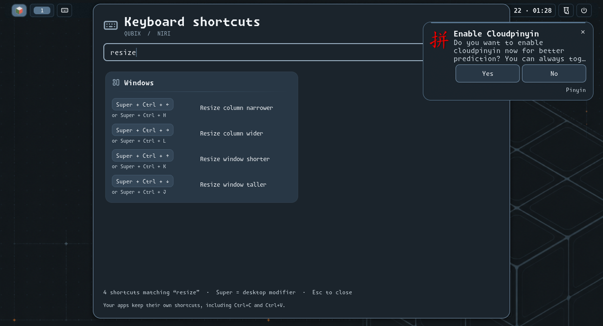
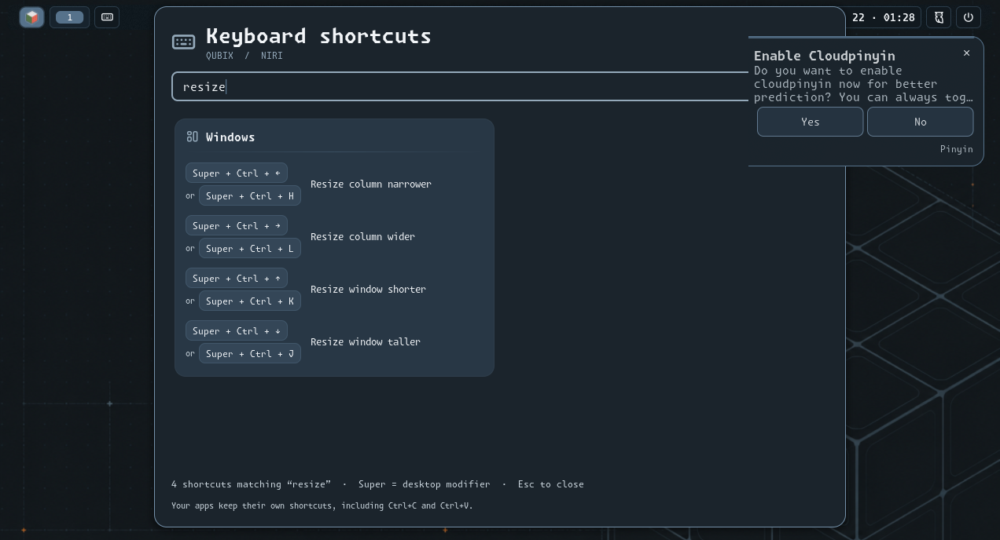
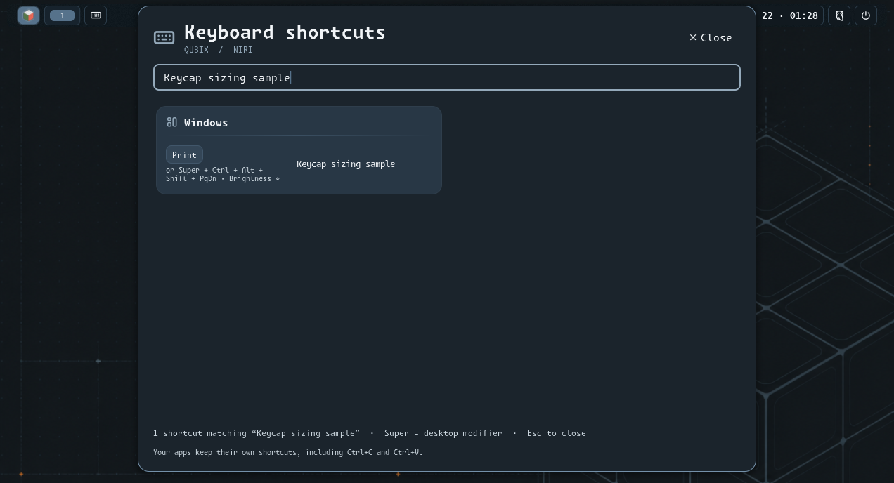
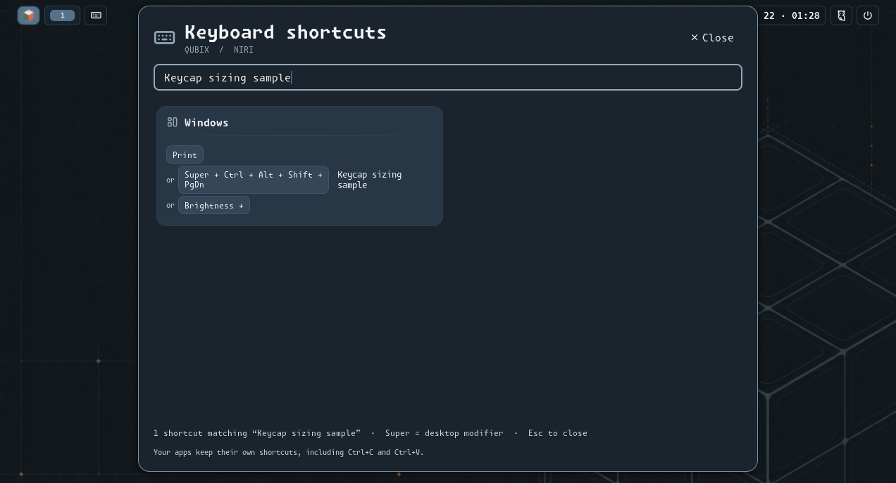

# Simple shortcuts and adaptive cheatsheet acceptance

Date: 2026-10-22. Source: parent `4d4a0fd` plus this change. Environment: the
operator-selected CachyOS SSH target, Niri 26.04 (`8ed0da4`), existing Qubix
Noctalia 5.3.0 Qubix session, internal eDP-1 and external HDMI-A-1 to its right at 100% scale.
Contract: [directional controls and keycaps](../architecture/desktop-design.md#simple-directional-controls-and-adaptive-keycaps).

Directional controls use Super to focus windows/cross screen edges, Shift to move
tiles, Ctrl to resize and Alt to move a window between screens, with both arrows
and H/J/K/L. Lock moves to Super+Escape. Earlier Ctrl+Alt/Shift screen families
and 10% bindings are superseded. Existing width presets/reset remain available.
The presenter retains generated KDL data, filtering and close/reopen behavior;
each shortcut/alias receives an intrinsic-width keycap with bounded text wrapping.

Controller desktop fixtures pass normal/check mode: 86 tasks/zero changes each,
with eight expected rescued refusal cases. Static validation passes. Native
comparison and installation pass as recorded below; identical reapplication passes 127 tasks/zero changes.

The native comparison renders the presenter from `4d4a0fd` against the customized
presenter with identical current bindings, then synthetic short/long/media aliases.
Both run in private nested Niri/Noctalia sessions; screenshots contain no personal
windows. Test-only paths, private state and synthetic stress bindings are intentional
differences from production. These screenshots show previews, not live activation.

The first reference attempt races asynchronous panel opening and stops before
capture; shared outer cleanup confirms zero leftovers and preserved primary
compositor/configuration/environment. The corrected test waits for panel state.
Physical keyboard events, vertical transfers and height resizing in stacked columns
remain operator gates; no boot writes, image rebuild or reboot are part of this task.

## Native results and visual comparison

Reference/candidate previews pass 93/92 tasks with 12/11 temporary/artifact changes.
Both validate plugin manifests/entry points, capture four views, exercise filtering
and close/reopen, and report zero remaining private processes. The primary compositor,
environment and personal configuration hashes remain preserved. Each image is a
1272×688 native nested screenshot, at 100% scale with the existing Krypton UI and
palette. Reference uses the presenter from `4d4a0fd`; customized uses this change.
Current bindings and synthetic stress data are identical in each pair.

Reference resize: the fixed 174-pixel key field contains a primary keycap and plain
alias text, reserving the same field width for differently sized keys.

Customized resize: both arrow and H/J/K/L alternatives have content-sized keycaps;
action text uses the remaining row width.

Reference stress: a short `Print` key plus a long chord/media alternative exposes
the old two-line alias truncation. These aliases are test-only display data.

Customized stress: the short cap remains compact; the full long chord wraps and
grows vertically; the media alias gets its own fitted cap. No personal content
or live activation is represented. Search-field state is explicitly synchronized
for both captures; production additionally resets the search field on reopening.

The scoped preview passes 115 tasks with three proposed changes. Installation
passes 127 tasks/six changes: managed Niri config, generated JSON, presenter and
three corresponding recovery receipts. Native KDL validation runs before atomic
installation; original baselines are retained. No plugin manifest or desktop-shell
restart is needed: Noctalia watches entry-script changes, and data reloads on open.
The existing operator panel is preserved during main-session checks; full presenter
open/filter/close/reopen behavior is tested in the isolated sessions above.
Identical identical reapplication passes 127 tasks/zero changes.

The final live regression passes three tasks/zero Ansible changes. It exercises
all 32 directional bindings from installed KDL/JSON: arrow/letter screen focus at
window boundaries, focused-window transfers, tiled movement, resize and no-neighbor
vertical actions. Starting at 942 pixels, Left/H resize to 846 pixels and Right/L
to 1037 pixels. Original focus, window/workspace assignments, personal hashes,
output settings, compositor PID and boot ID match afterward; the test terminal
exits. The first live attempt stops at an already-open operator panel; its
cleanup restores focus/removes the terminal. The final test preserves that panel
and records the exact interaction scope instead of closing it.

All 16 arrow/letter action/label pairs match and directional chords use at most
two modifiers. The lock descriptor is Super+Escape; tests never execute locking.
No boot acceptance is claimed. Pending: physical key input, vertical screen
arrangements, stacked height interaction and unplug/replug behavior.
