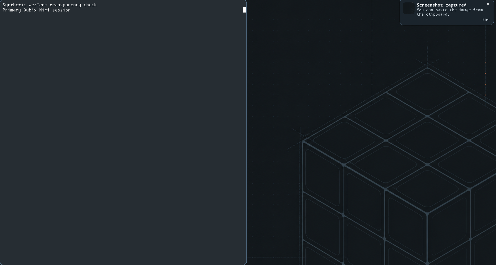
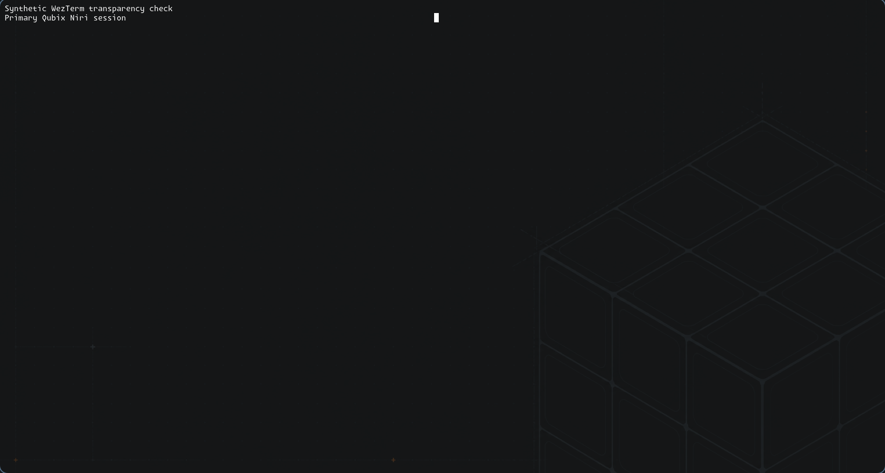
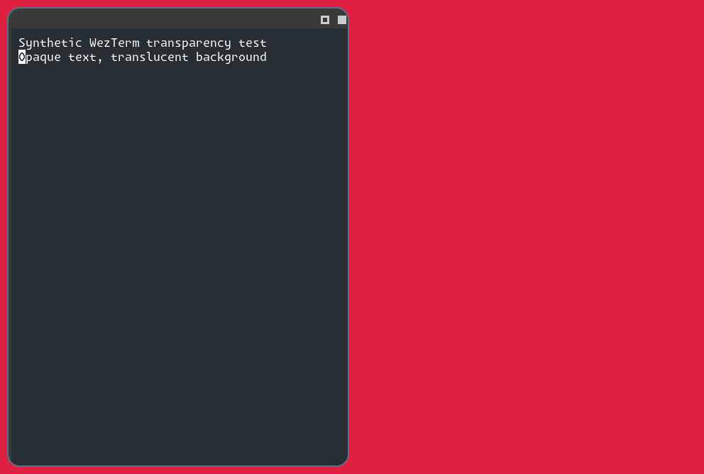
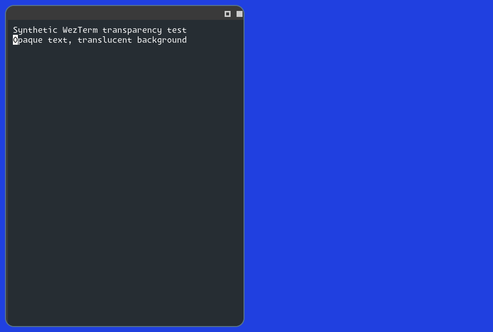
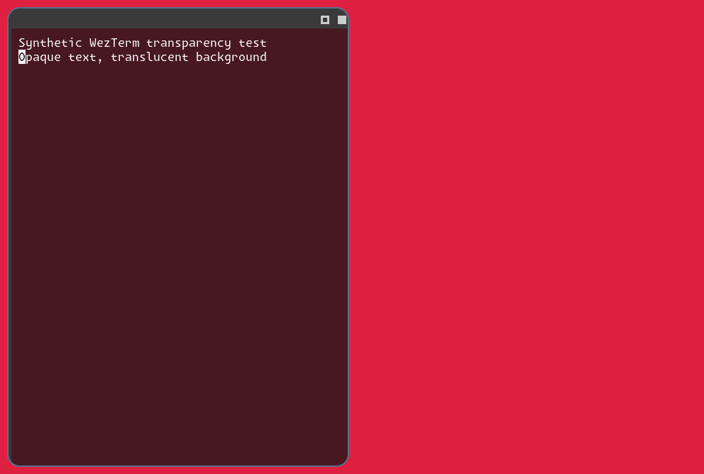
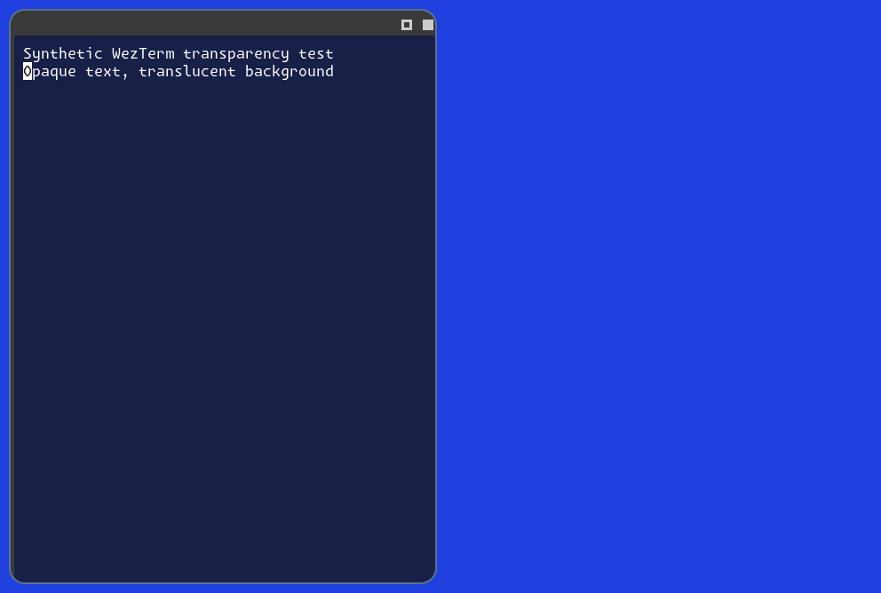

# WezTerm home configuration and composed transparency correction

## Primary-session repair (2026-10-20)

The earlier **live transparency activation claim below is superseded**. Diagnosis
against source `6b96c99` found `/etc/niri/qubix/theme.kdl` corrected, but the active
`/usr/bin/niri --session --config /etc/niri/qubix/config.kdl` still loaded an older
embedded theme without the rule. The earlier focused resource selection omitted
`config.kdl`; nested rendering tested the candidate theme, hiding that deployment gap.
The installed Lua still requested 0.75 opacity. Its user-edited decoration setting
is preserved by this compositor-only repair.

Acceptance: reconcile only the rendered managed session configuration using existing
backup/receipt handling; validate/reload it; prove background mixing with a synthetic
terminal in the primary session; preserve account files, applications and boot identity;
require the installed session config to contain the candidate theme before future
nested acceptance. The new integration assertion rejects the unfixed target with
two successful tasks, zero changes and one expected failure before rendering.

Environment remains CachyOS x86-64, Niri 26.04 and WezTerm
`20260716-195552-76b606ec`, primary Niri PID 1145, same boot ID recorded below.
The preview proves the only config difference is the five-line scoped WezTerm rule.
File installation/verification passes 89 tasks/two changes (config and checksum
receipt); existing recovery metadata is retained. Identical-source reapplication
passes 89 tasks/zero changes. Native Niri validation and live
rule reload pass. No session/application restart is needed. Controller
`./scripts/validate.sh` passes. The revised native integration passes 11 tasks/five
temporary changes, including installed-theme verification and the same red/blue
pixel controls recorded below. No boot activation or reboot is performed.

Primary-session screenshots contain only a synthetic terminal and the managed
wallpaper. Bar/notification areas are cropped away. The terminal occupies half the
output before and the full available width after the temporary nested-window test;
this geometry difference is incidental. For 240 blank interior samples in their
common region, the before pixels are uniformly `(38,45,51)`; after pixels match
75% `#161616` plus 25% of the separately captured actual wallpaper within one RGB
level. At `(100,400)` the wallpaper is `(18,24,27)` and corrected terminal `(21,22,23)`.
The wallpaper geometry is visible through the corrected terminal. These are live
primary-session captures, distinct from the isolated comparison below.

Reference: source `6b96c99`, stale embedded session theme, solid fill obscures the
wallpaper inside the half-width terminal. Other visible content is managed wallpaper.

Customized: same source plus rendered session-rule repair; primary-session wallpaper
shows through at supplied 0.75 opacity. Wider geometry follows the temporary nested
test. Account Lua, personal Niri/dconf hashes and boot ID remain unchanged. The owned
synthetic terminal is stopped after capture and the original empty window set restored.

### Historical nested evidence

Status: **Implemented and Tested on the operator-authorized SSH target**, 2026-10-18.
Source candidate is based on `4c90254`. Canonical Lua SHA-256:
`bcdf3f0e2af2a50cf1e047c033be178f6d9576b34f1e85b1590231ab9511d464`;
compositor theme SHA-256:
`2d4e31a12f2bdad75ccc499fd94bf92d17c41754e121e1f0096df83d80c07c3a`.
The commit containing this document identifies the complete tested source.

Environment: CachyOS x86-64, Niri 26.04 (`8ed0da4`), WezTerm
`20260716-195552-76b606ec`, unchanged active Niri PID 1145 and native home
`/home/qubik65536`. The supplied Lua and palettes are installed as that account under
`~/.config/wezterm`, mode 0644. Source contains exactly one `wezterm.lua`; original
input digests and the earlier original Git revision remain in the provenance record.

## Separate gates

| Gate | Actual evidence |
|---|---|
| Controller | Repository validation passes; desktop fixture: 71 tasks/zero changes, seven expected refusals. Compatibility-wrapper argument test passes. Static consistency enforces one canonical Lua. |
| Home backups/refusal | Disposable account fixture: 40 tasks/eight temporary fixture changes, one expected refusal. Existing Lua bytes survive in the copy backup, repeat copies are unchanged, and dangling redirected configuration fails preflight. Its no-effect validator is explicitly fixture-only; it does not claim native parsing. |
| Native home installation | Successful account phase: 12 tasks/two changed tasks (directory/copy loops); all three contents, UID and modes verified. Native configuration loading passes. The first combined run applied the two system corrections but stopped on an intermediate fact-name mismatch before home writes; that attempt is not counted as completed deployment. |
| Combined reapplication | Corrected system theme/wrapper and all home files: 116 tasks/zero changes/failures. Separate account-only repeat: 11 tasks/zero changes. |
| Native configuration controls | Updated focused native workflow: 12 tasks/five temporary changes, zero failures. Installed home config accepted; invalid syntax and unsupported-option controls rejected; synthetic native/home-config windows render and close. |
| Direct launch/activation | Unqualified `/usr/bin/wezterm ls-fonts` loads the home config and resolves Monaspace Krypton NF. Native Niri validation and live config reload pass; no Niri, Noctalia, manager or application restart is performed. |
| Composed transparency | Private nested scene workflow: nine tasks/four temporary changes, zero failures. All four composed output captures pass numeric interior-pixel assertions below. |
| Preservation/boot | Nested test preserves the operator's window IDs/PIDs and original focus, personal Niri/dconf/new WezTerm hashes and boot identity. Niri socket remains `niri.wayland-1.1145.sock`; boot ID remains `be7bf359-b534-4227-9947-f34d2b63936d`. No package transaction or boot activation/rebuild/reboot occurs. |

The actual problem was Niri's solid focus-ring backdrop beneath the translucent
surface. The WezTerm-only `draw-border-with-background false` rule fixes composition;
background opacity stays 0.75 and no whole-window opacity is applied to the text.
[Upstream documents this distinction](https://github.com/niri-wm/niri/wiki/Configuration:-Window-Rules#draw-border-with-background).
Earlier terminal-surface captures could show a colour change without proving the
scene behind the window was visible; these composed-output controls replace that gate.

## Controlled comparison

Both windows run in the same private nested compositor with temporary HOME/XDG state,
the installed home config copied into that private home, and fixed synthetic text.
The control enables the former background fill; the corrected scene disables it.
Red/blue scene backgrounds are the only other variable. Captures show only the nested
output, never the operator's desktop. All test processes, temporary files and sockets
are cleaned up, and the operator's previous focus is restored.

| Blank terminal interior at (100,400) | Red scene | Blue scene |
|---|---|---|
| Before: backdrop fill enabled | `(38,45,51)` | `(38,45,51)` |
| After: backdrop fill disabled | `(72,24,32)` | `(24,32,72)` |

The identical control pixels establish the masking defect. Corrected pixels change
with the scene and match 75% Oxocarbon background mixed with 25% scene colour.
`tests/static/check_wezterm_transparency.py` decodes the captured PNGs using the
standard library and asserts the control equality and corrected red/blue response.

Reference control: the terminal's translucent surface is backed by solid focus-ring fill.
Niri/WezTerm versions and source fingerprints are recorded above; all content is synthetic.

Reference control over blue: the terminal interior stays the same solid colour.

Customized compositor rule, same WezTerm config: red visibly shows through the background;
foreground glyphs remain opaque. No blur, palette change or whole-window fade is added.

Customized rule over blue: a different background mix confirms actual scene transparency.

Repeat after deployment with `tests/integration/wezterm-transparency.yml`; it fetches
captures under `.cache/wezterm-transparency/` and runs the pixel check on the controller.
Home-file rollback uses the timestamped copy backups where originals existed; generic
system-file restore does not manage this account directory. Other personal files are
preserved. Physical input/fullscreen appearance and broader account-file restore
integration remain separate follow-up work.
