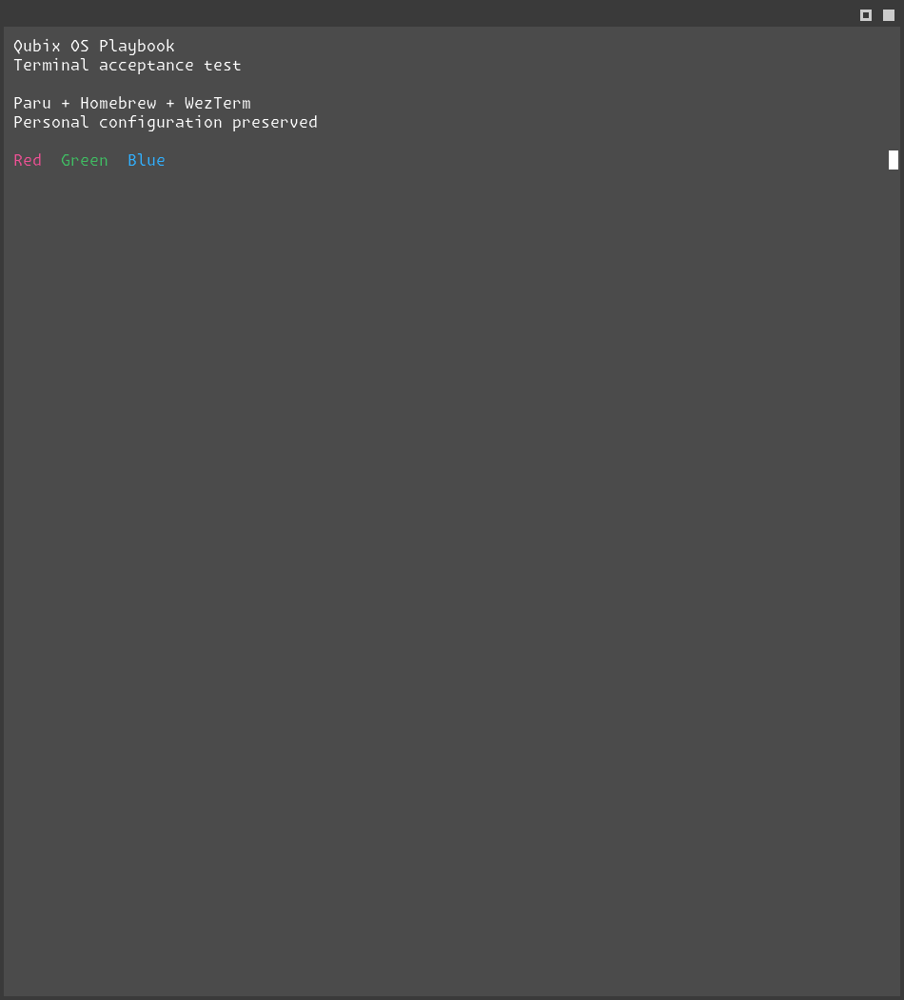

# Supplied WezTerm defaults: SSH acceptance

Status: **Implemented; controller/native parser, installation, rendering, activation,
preservation and reapplication Tested**. Source: `e9323c1`, with native-validator
correction `2d012cf`, tested on 2026-10-17. The source directory is preserved byte-for-byte
with [provenance digests](../../assets/wezterm/provenance.json); runtime adaptation is
specified by the [component contract](../components/wezterm.md).

The later [home configuration and composed transparency correction](wezterm-home-test-results.md)
supersedes this system-path layout and surface-only transparency evidence.

The operator explicitly requested this deployment to the existing SSH instance.
Environment: CachyOS x86-64, WezTerm `20260716-195552-76b606ec`, Qubix Niri PID 1145,
1920×1080 output at 100% scale, and the existing private Noctalia client. Package,
login, bootloader and Plymouth changes were excluded from this configuration-only task.

## Separate acceptance gates

| Gate | Actual evidence |
|---|---|
| Controller | Repository validation passes; desktop fixture: 71 tasks/zero changes, seven expected refusals. Shell fixture checks explicit flags/environment, all native personal-config locations including dangling symlinks, argument preservation and no personal-file replacement. |
| Ownership/recovery | Disposable local filesystem fixture: 74 tasks/eight fixture changes, two expected refusals. The exact Niri desktop override installs, reapplies unchanged and restores original absence; other local paths/components remain refused. |
| Private native candidate | Imported Lua and both palettes pass native loading in a private directory. Corrected validator also rejects syntax and unsupported-option controls: eight tasks, six temporary fixture changes, zero failures. |
| Target preview | Eight selected terminal resources: 178 tasks/eight proposed changes; no target writes. An earlier preview refused the new desktop path until the exact ownership exception was implemented/tested. |
| Installation | Eight selected resources installed with the shared protected-file engine: 218 tasks/24 changes, zero failures. Existing first baselines are retained. Global full-profile deployment state is preserved; this is targeted installation. |
| Reapplication | All eight initial resources: 210 tasks/zero changes. The subsequent validator correction installs separately (18 tasks/two changes including its receipt) and reapplies with 18 tasks/zero changes. |
| Installed verification | Final corrected source: all eight contents/modes match; 76 tasks/zero changes/failures. |
| Native parser | Installed production config accepted; syntax and unsupported-option controls rejected. `ls-fonts` plus error diagnostics is required: `show-keys` can return success without loading the supplied config, and other CLI commands can report an error while returning zero. The first native negative run caught that bug; only the corrected control run counts as acceptance. |
| Font selection | Native `qubix-wezterm ls-fonts` resolves the primary face to `Monaspace Krypton NF`, `/MonaspaceKryptonNF-Regular.otf`. Fallback family names remain as supplied; additional IBM Plex faces are not installed by this task. |
| Session activation | Guarded Noctalia-only restart: PID 10663 → 21613, active TERMINAL points to the managed wrapper. Niri reload succeeds; both shortcuts select the wrapper. The same-ID local desktop entry uses it while the native package desktop file remains unchanged. |
| Rendering/preservation | Reusable native test: 11 tasks/six temporary changes, zero failures. Native/default and supplied windows render; all original application IDs/PIDs, personal WezTerm/dconf hashes and boot ID are preserved. A final read-only audit also matches all 11 previously measured native/personal configuration hashes. Original focus is restored. Test windows and temporary files are removed. |
| Boot | Boot ID remains `be7bf359-b534-4227-9947-f34d2b63936d`. No reboot, manager restart, package transaction or initramfs rebuild is performed. |

The first rendering run hit an interactive close confirmation in its private reference
window; that attempt is not accepted. Cleanup now terminates only each test's own
new process group. A cleanup check and the successful final rendering run leave no
synthetic windows behind, without terminating any pre-existing terminal.

## Reference and customized comparison

Captures below use the same installed WezTerm version and compositor with a private
HOME/XDG state and fixed synthetic text. They capture only the test window surface,
excluding neighboring applications and personal terminal initialization. They establish
real rendering in the active graphical session, not physical keypress acceptance.


Native reference: `wezterm --skip-config`, default font/colours and visible tab bar.
Source `e9323c1` with validator correction `2d012cf`; CachyOS/Niri environment above.



Customized: the production wrapper selects the installed supplied configuration.
Intentional differences: Oxocarbon Dark colours, Monaspace Krypton NF, 0.75 background
opacity, RESIZE decorations, simple tab bar hidden for one tab, and the supplied Alt
behavior. macOS blur is guarded on Linux; no Linux blur is added. Both original colour
schemes ship, with Oxocarbon selected. Personal/explicit configuration retains precedence.

## Repeat the focused native test

After package and configuration deployment, run:

```bash
.venv/bin/ansible-playbook -i inventory/target.local.ini tests/integration/wezterm.yml -e @config/local.yml
```

Use the same SSH/become credentials as ordinary deployment. The test creates and closes
only private synthetic windows, fetches captures under `.cache/wezterm-native/` and removes
its temporary target directories. It does not run in check mode.

Remaining manual acceptance: physical Super+T/Super+Return and launcher selection, both
Alt keys, transparency over the operator's chosen background and fallback glyph coverage.
Direct `/usr/bin/wezterm` remains the native binary; managed appearance is selected by
Qubix shortcuts, its terminal environment and the effective desktop entry. Existing
WezTerm windows using earlier settings are preserved. Native `start` can reuse an
existing GUI process; to inspect these defaults immediately without closing earlier
windows, run `/usr/share/qubix/bin/qubix-wezterm start --always-new-process`. See the
[upstream start interface](https://wezterm.org/cli/start.html).
